# Manual de usuario MVP

Guia para validar Civora en staging con el dataset piloto simulado. Esta guia
esta pensada para una persona que entra por primera vez al sistema.

## Tabla de contenido

- [Antes de empezar](#antes-de-empezar)
- [Acceso y usuarios piloto](#acceso-y-usuarios-piloto)
- [Mapa de navegacion](#mapa-de-navegacion)
- [Roles y permisos](#roles-y-permisos)
- [Flujo 1: iniciar sesion y abrir el proyecto piloto](#flujo-1-iniciar-sesion-y-abrir-el-proyecto-piloto)
- [Flujo 2: revisar proyecto y fase](#flujo-2-revisar-proyecto-y-fase)
- [Flujo 3: revisar partidas y avance ejecutado](#flujo-3-revisar-partidas-y-avance-ejecutado)
- [Flujo 4: revisar presupuesto aprobado](#flujo-4-revisar-presupuesto-aprobado)
- [Flujo 5: revisar calidad, rechazo y no conformidad](#flujo-5-revisar-calidad-rechazo-y-no-conformidad)
- [Flujo 6: revisar subcontratos y estimaciones](#flujo-6-revisar-subcontratos-y-estimaciones)
- [Flujo 7: revisar costo del proyecto](#flujo-7-revisar-costo-del-proyecto)
- [Flujo 8: revisar reporte interno](#flujo-8-revisar-reporte-interno)
- [Flujo 9: revisar auditoria](#flujo-9-revisar-auditoria)
- [Glosario](#glosario)
- [Problemas comunes](#problemas-comunes)

## Antes de empezar

- Ambiente: <https://civora-staging.onrender.com>
- Proyecto: `MVP Piloto Simulado - Residencial Las Palmas`
- Dataset: simulado, realista y sin informacion sensible.
- No suba informacion real, sensible, personal ni contractual durante la
  validacion.
- R2 esta diferido. La evidencia valida metadatos, carga, relaciones y
  auditoria, pero el binario usa fallback local y no debe considerarse durable
  entre redeploys o reinicios de Render.

Si Render esta inactivo, la primera carga puede tardar varios segundos.

## Acceso y usuarios piloto

Todos los usuarios piloto usan la clave inicial:

```text
Civora pilot 2026!
```

| Rol | Email | Uso recomendado |
| --- | --- | --- |
| Administrador | `piloto.admin@civora.test` | Ejecutar la validacion completa. |
| Director de proyecto | `piloto.director@civora.test` | Revisar operacion general del proyecto. |
| Presupuesto | `piloto.presupuesto@civora.test` | Revisar partidas, fichas y presupuesto. |
| Calidad | `piloto.calidad@civora.test` | Revisar controles de calidad y no conformidades. |
| Finanzas | `piloto.finanzas@civora.test` | Revisar subcontratos, estimaciones y costo. |
| Consulta | `piloto.consulta@civora.test` | Revisar informacion sin modificar registros. |

Pantalla de inicio de sesion:

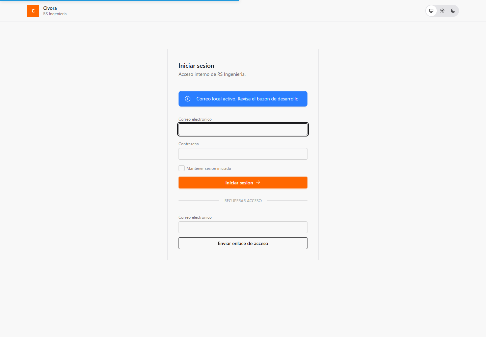

## Mapa de navegacion

Despues de iniciar sesion, la pantalla inicial muestra los proyectos asignados.
Abra el proyecto piloto desde la fila con nombre
`MVP Piloto Simulado - Residencial Las Palmas`.

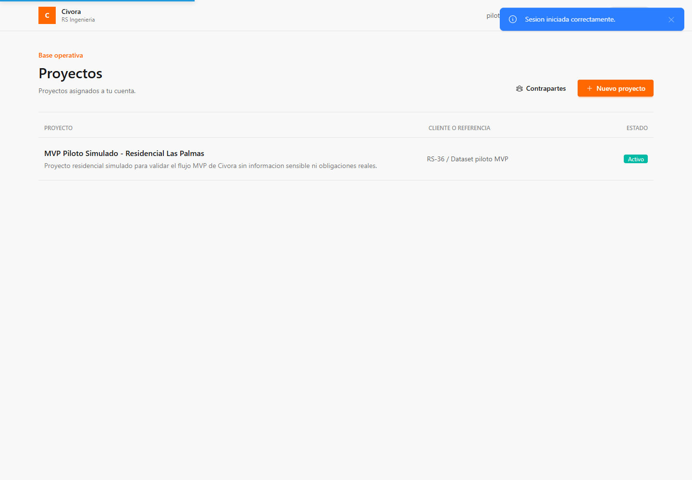

Dentro del proyecto, las opciones principales aparecen arriba:

- `Reporte`: resumen operativo para validacion ejecutiva.
- `Subcontratos`: acuerdos, partidas cubiertas y estimaciones.
- `Costo`: costo acumulado desde estimaciones.
- `Presupuesto`: linea base aprobada.
- `Partidas`: partidas de obra, avance, calidad, no conformidades y evidencia.
- `Auditoria`: eventos criticos registrados por el sistema.

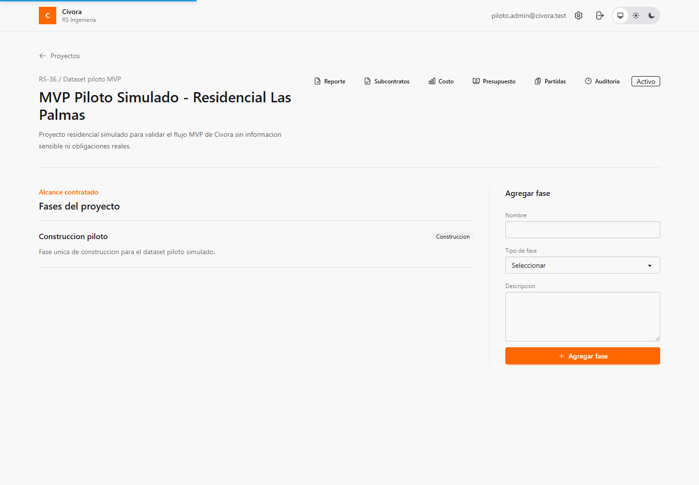

## Roles y permisos

| Area | Administrador | Director | Presupuesto | Calidad | Finanzas | Consulta |
| --- | --- | --- | --- | --- | --- | --- |
| Ver proyecto | Si | Si | Si | Si | Si | Si |
| Gestionar fases y partidas | Si | Si | Si | No | No | No |
| Ver presupuesto | Si | Si | Si | Si | Si | Si |
| Registrar avance ejecutado | Si | Si | No | No | No | No |
| Registrar calidad y no conformidad | Si | Si | No | Si | No | No |
| Gestionar subcontratos y estimaciones | Si | No | No | No | Si | No |
| Ver costo y reporte | Si | Si | Si | Si | Si | Si |
| Ver auditoria | Si | Si | Si | Si | Si | Si |

Si una accion no aparece para un usuario, normalmente es por el rol activo.

## Flujo 1: iniciar sesion y abrir el proyecto piloto

Objetivo: confirmar que el usuario puede entrar a staging y encontrar el
proyecto piloto.

Permisos: cualquier usuario piloto.

Prerequisitos: staging debe tener cargado el dataset RS-36.

Pasos:

1. Abrir <https://civora-staging.onrender.com>.
2. Ingresar el email del usuario piloto.
3. Ingresar la clave `Civora pilot 2026!`.
4. Presionar `Iniciar sesion`.
5. En `Proyectos`, abrir `MVP Piloto Simulado - Residencial Las Palmas`.

Resultado esperado: el sistema muestra el detalle del proyecto y la fase
`Construccion piloto`.

## Flujo 2: revisar proyecto y fase

Objetivo: confirmar la estructura base requerida para RS-37.

Permisos: cualquier usuario piloto.

Prerequisitos: estar dentro del proyecto piloto.

Pasos:

1. Revisar nombre, referencia y descripcion del proyecto.
2. Confirmar que el estado es `Activo`.
3. Confirmar que existe la fase `Construccion piloto`.
4. Confirmar que la fase aparece como tipo `Construccion`.

Resultado esperado: hay 1 proyecto y 1 fase de construccion, ambos visibles.

## Flujo 3: revisar partidas y avance ejecutado

Objetivo: validar que el presupuesto operativo tiene partidas con avance
ejecutado cargado.

Permisos: cualquier usuario piloto puede revisar; administrador y director
pueden registrar avance adicional si se necesita una prueba controlada.

Prerequisitos: estar dentro del proyecto piloto.

Pasos:

1. Entrar a `Partidas`.
2. Confirmar que hay 4 partidas.
3. Abrir una partida.
4. Revisar sus actividades de obra.
5. Revisar los avances ejecutados ya cargados.
6. Revisar la evidencia ficticia asociada cuando aparezca en la partida.

Resultado esperado: cada partida tiene avance ejecutado y el detalle muestra
actividad, avance, calidad, no conformidades y evidencia relacionada.

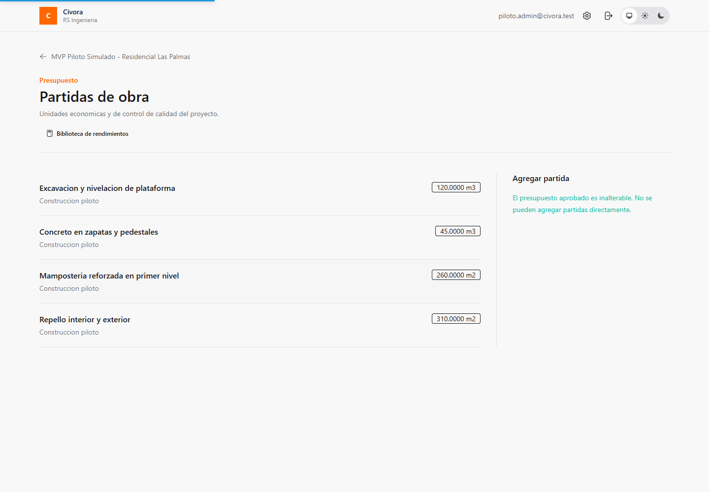

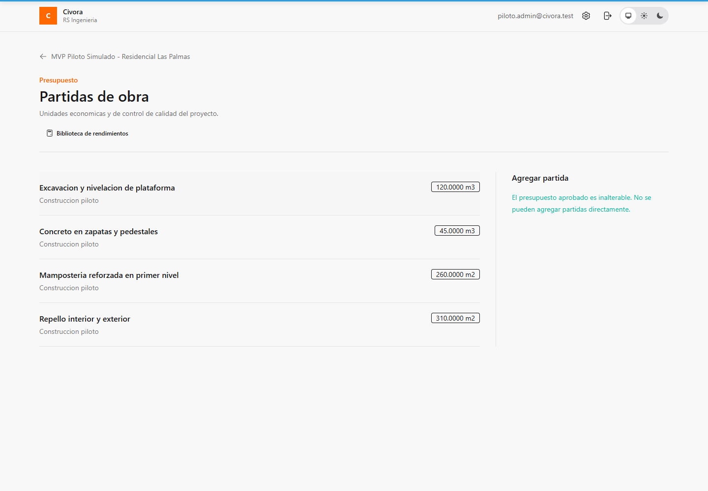

## Flujo 4: revisar presupuesto aprobado

Objetivo: confirmar que existe una linea base aprobada para comparar contra
avance, estimaciones y costo.

Permisos: cualquier usuario piloto puede revisar.

Prerequisitos: estar dentro del proyecto piloto.

Pasos:

1. Entrar a `Presupuesto`.
2. Confirmar que el presupuesto aparece como aprobado.
3. Revisar las 4 partidas presupuestadas.
4. Revisar cantidades, unidades, fichas de rendimiento y recursos.

Resultado esperado: el presupuesto aprobado es visible y no se trata como un
borrador editable durante la validacion.

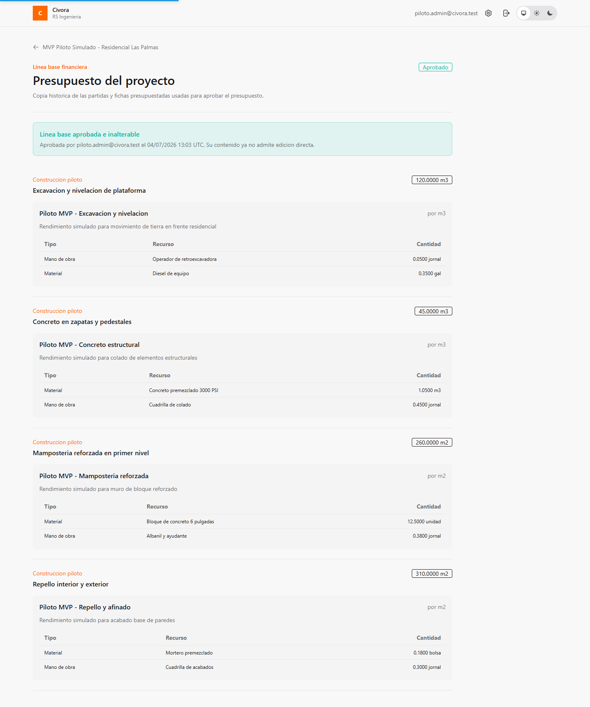

## Flujo 5: revisar calidad, rechazo y no conformidad

Objetivo: comprobar que el flujo de calidad diferencia avance ejecutado, avance
pagable, rechazo y no conformidad.

Permisos: administrador, director y calidad pueden registrar controles; todos
los usuarios piloto pueden revisar.

Prerequisitos: abrir una partida con avance ejecutado.

Pasos:

1. En `Partidas`, abrir `Concreto en zapatas y pedestales`.
2. Revisar los controles de calidad del avance ejecutado.
3. Confirmar que existe aceptacion parcial con cantidad rechazada.
4. Revisar la no conformidad abierta:
   `Cangrejera localizada en pedestal P3 posterior al desencofrado`.
5. Confirmar que la no conformidad mantiene responsable, cantidad afectada,
   fecha de vencimiento y evidencia ficticia.

Resultado esperado: el reporte y la partida muestran 1 no conformidad abierta y
el avance rechazado no se cuenta como pagable.

## Flujo 6: revisar subcontratos y estimaciones

Objetivo: validar contraparte, subcontrato, avance estimable y estimaciones.

Permisos: cualquier usuario piloto puede revisar; administrador y finanzas
pueden gestionar estimaciones.

Prerequisitos: estar dentro del proyecto piloto.

Pasos:

1. Entrar a `Subcontratos`.
2. Confirmar que hay 2 subcontratos.
3. Abrir `Piloto MVP - Obra gris inicial`.
4. Revisar partidas incluidas y condiciones comerciales.
5. Revisar `Avance ejecutado vs pagable`.
6. Confirmar que hay estimaciones generadas.
7. Volver y repetir la revision con `Piloto MVP - Mamposteria y acabados`.

Resultado esperado: existen 2 estimaciones de subcontrato y sus lineas se
basan en avance aprobado como pagable.

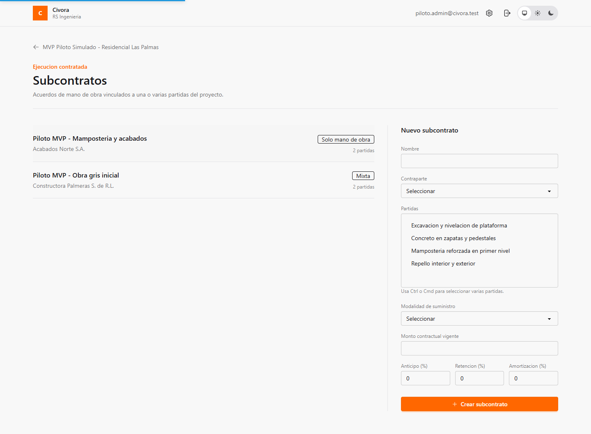

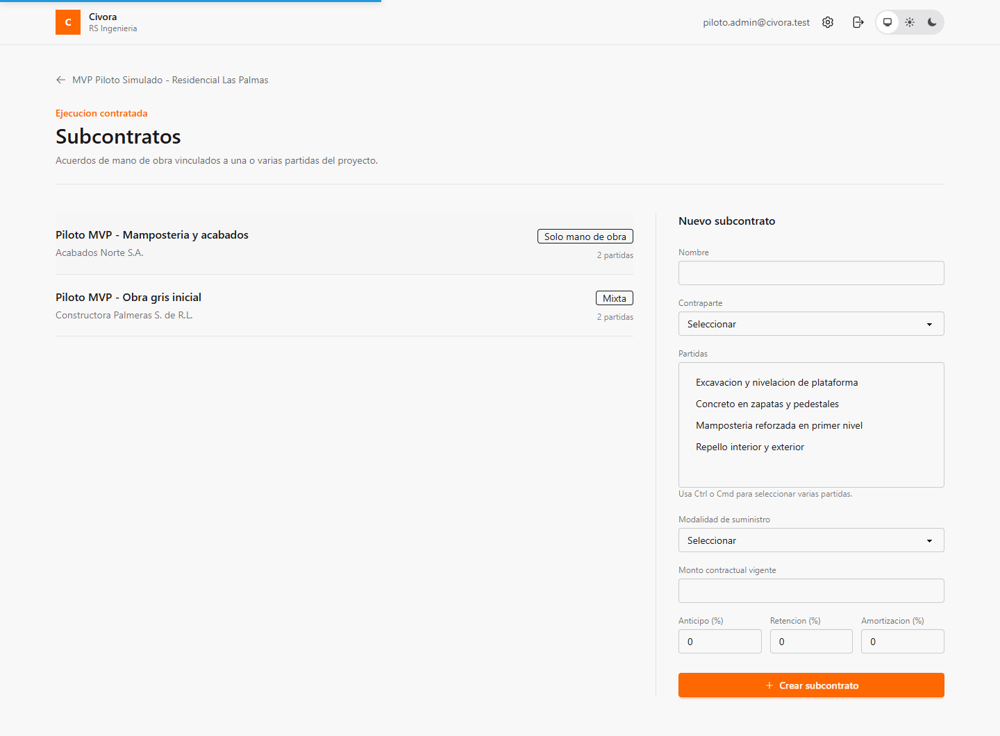

## Flujo 7: revisar costo del proyecto

Objetivo: confirmar que Civora acumula costo desde las estimaciones generadas.

Permisos: cualquier usuario piloto puede revisar.

Prerequisitos: estar dentro del proyecto piloto.

Pasos:

1. Entrar a `Costo`.
2. Revisar el monto contratado.
3. Revisar el estimado acumulado.
4. Revisar el saldo basico.
5. Confirmar que aparecen 2 estimaciones.

Resultado esperado: el costo acumulado coincide con la suma de estimaciones y
sirve como cierre del flujo desde proyecto hasta costo.

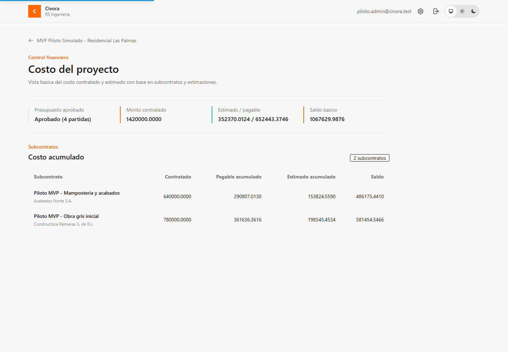

## Flujo 8: revisar reporte interno

Objetivo: validar la vista consolidada para Product Owner y usuarios de negocio.

Permisos: cualquier usuario piloto puede revisar.

Prerequisitos: estar dentro del proyecto piloto.

Pasos:

1. Entrar a `Reporte`.
2. Revisar los indicadores superiores:
   partidas presupuestadas, avance estimado/pagable, no conformidades abiertas
   y costo acumulado.
3. Revisar presupuesto, avance, calidad y costo en la misma vista.
4. Confirmar que el reporte muestra 4 partidas, 1 no conformidad abierta y 2
   estimaciones.

Resultado esperado: el reporte permite explicar el estado del proyecto sin
abrir cada modulo por separado.

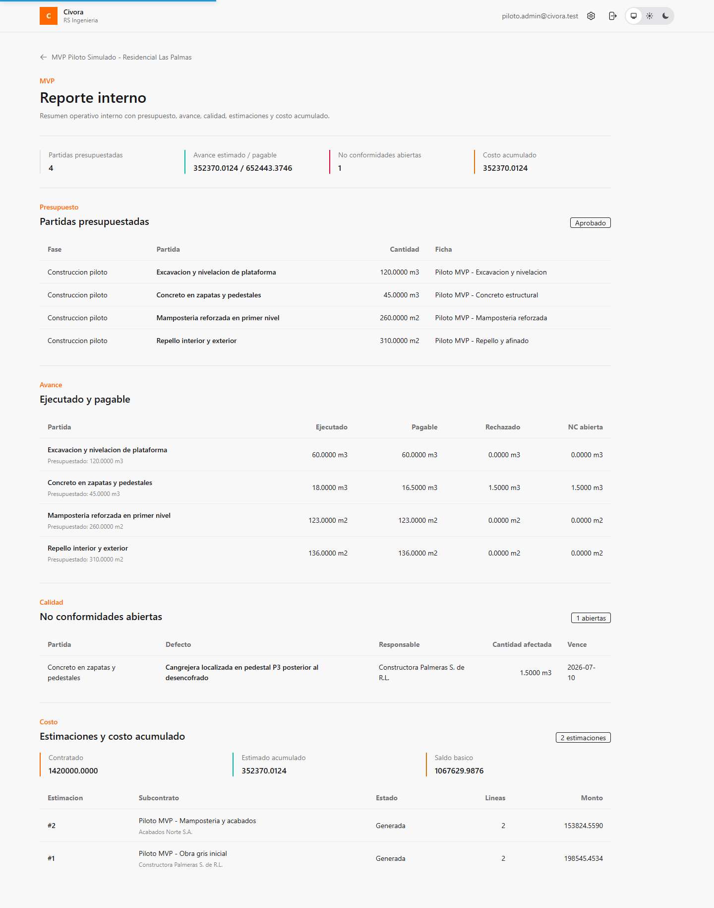

## Flujo 9: revisar auditoria

Objetivo: confirmar trazabilidad de acciones criticas.

Permisos: cualquier usuario piloto puede revisar.

Prerequisitos: estar dentro del proyecto piloto.

Pasos:

1. Entrar a `Auditoria`.
2. Revisar eventos de proyecto, presupuesto, avance, calidad, no conformidad,
   estimaciones y evidencia.
3. Confirmar que los eventos tienen actor, accion, entidad y fecha.

Resultado esperado: la auditoria permite rastrear cambios relevantes del flujo
piloto.

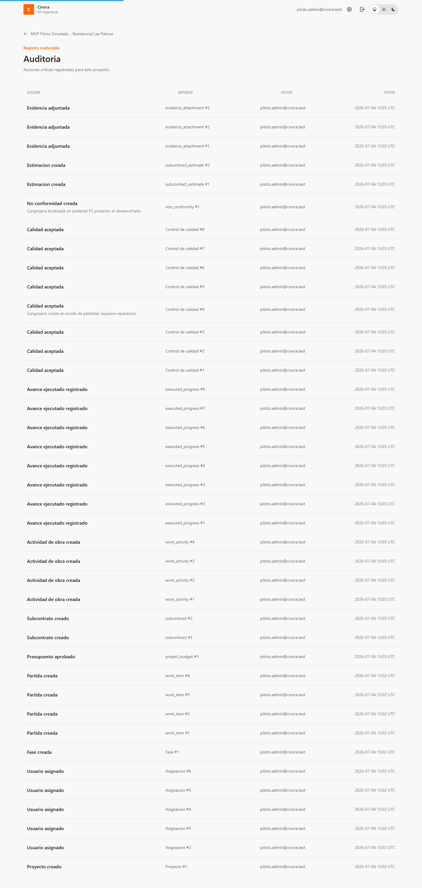

## Glosario

| Termino | Significado |
| --- | --- |
| Proyecto | Obra o contrato administrado en Civora. |
| Fase | Agrupacion principal del alcance del proyecto. |
| Partida | Elemento medible del presupuesto y de la ejecucion. |
| Ficha de rendimiento | Receta tecnica de recursos, unidad y productividad usada para presupuestar. |
| Presupuesto aprobado | Linea base inalterable contra la que se compara la ejecucion. |
| Actividad de obra | Trabajo ejecutable asociado a una partida. |
| Avance ejecutado | Cantidad reportada como realizada en campo; aun no necesariamente pagable. |
| Control de calidad | Revision que acepta o rechaza avance ejecutado. |
| Avance pagable | Cantidad aceptada por calidad y disponible para estimacion. |
| No conformidad | Defecto o incumplimiento que requiere seguimiento. |
| Contraparte | Proveedor o subcontratista registrado globalmente. |
| Subcontrato | Acuerdo con una contraparte para ejecutar partidas del proyecto. |
| Estimacion | Documento de pago generado con lineas basadas en avance pagable. |
| Costo acumulado | Suma de estimaciones generadas para el proyecto. |
| Evidencia | Archivo o metadato asociado a avance, calidad o no conformidad. |
| Auditoria | Registro inalterable de eventos criticos. |

## Problemas comunes

| Situacion | Que hacer |
| --- | --- |
| Staging tarda en abrir | Esperar y recargar; Render puede estar despertando el servicio. |
| No puedo iniciar sesion | Verificar email, clave y que no haya espacios al copiar. |
| No veo el proyecto piloto | Confirmar que se uso un usuario `piloto.*@civora.test`; si persiste, pedir que se ejecute RS-36 en staging. |
| No veo una accion de crear o editar | Revisar el rol activo; algunas acciones no aparecen para consulta, calidad, presupuesto o finanzas. |
| Una evidencia no descarga despues de redeploy | Es una limitacion conocida mientras R2 esta diferido; validar metadatos y auditoria, no retencion durable del binario. |
| El reporte no coincide con una prueba manual nueva | Revisar si se agregaron datos durante la sesion; anotar el ajuste en RS-37 y priorizarlo como blocker, V1 o backlog. |

